# Building a Custom VPC on AWS

[Live website](https://aws.rajeabilal.com/) · [LinkedIn post and project walkthrough](https://lnkd.in/p/eW5QvqYP)

## Architectural drawing for the project

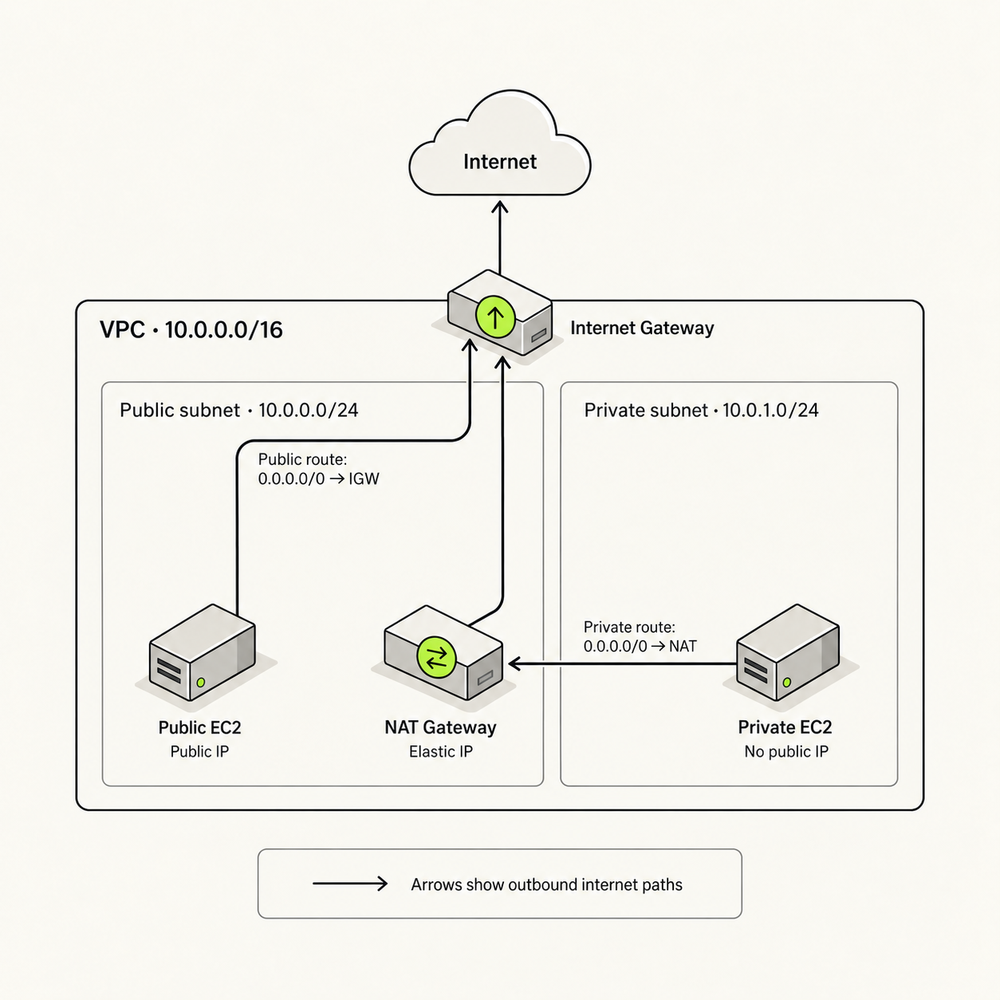

I built this project as part of my CoderCo DevOps learning to understand how networking works in AWS. I wanted to create the resources myself and understand how they connect: the VPC, subnets, route tables, gateways and EC2 instances.

The goal was to host a website on an EC2 instance in a public subnet, with another EC2 instance in a private subnet. Along the way, I worked through a few mistakes that helped me understand what actually makes a subnet public and why creating a route table isn't enough on its own.

The biggest error? My public route table had a route to the internet gateway, but I hadn't explicitly associated it with my public subnet. So the website still wouldn't load.

## What I built

| Resource                   | Its role in this project                                  |
| -------------------------- | --------------------------------------------------------- |
| Custom VPC                 | My own network in AWS                                     |
| Public subnet              | Held the public EC2 instance and the zonal NAT gateway    |
| Private subnet             | Held an EC2 instance without a public IP address          |
| Internet gateway           | Connected the VPC to the internet                         |
| Route tables               | Told traffic where to go, depending on its destination    |
| NAT gateway and Elastic IP | Provided an outbound internet path for the private subnet |
| Public EC2 instance        | Hosted my Apache website and acted as the bastion host    |
| Private EC2 instance       | Kept separate from direct access from the internet        |
| Security groups            | Controlled which connections could reach each instance    |

I built the project in the Europe (Stockholm) region, using a VPC named `custom-vpc-01`.

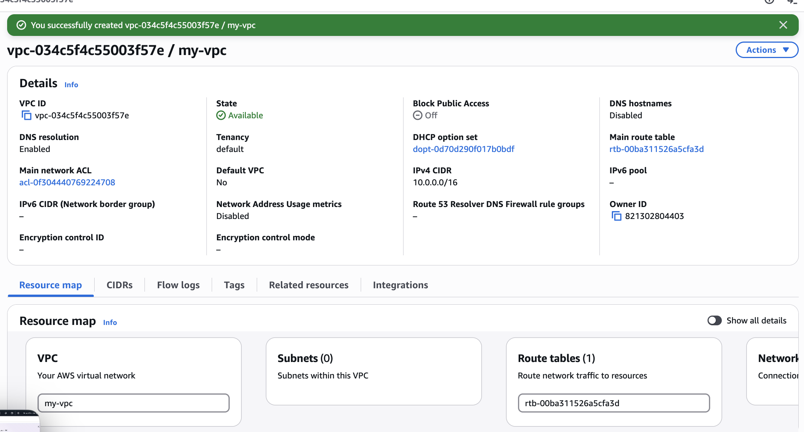

## 1. Creating the VPC and subnets

I started by creating a custom VPC with the IPv4 CIDR block `10.0.0.0/16`.

The `CIDR` block defines the range of IP addresses available inside the VPC.

I then created two subnets within that range: one for the public resources and one for the private resources.

Both subnets were in the same `Availability Zone` for this project. Each needed its own address range, inside the VPC's range, without overlapping the other subnet.

I ran into an overlap error here. This helped me understand that subnet ranges need to be separate. Changing the subnet name doesn't change which addresses it contains.

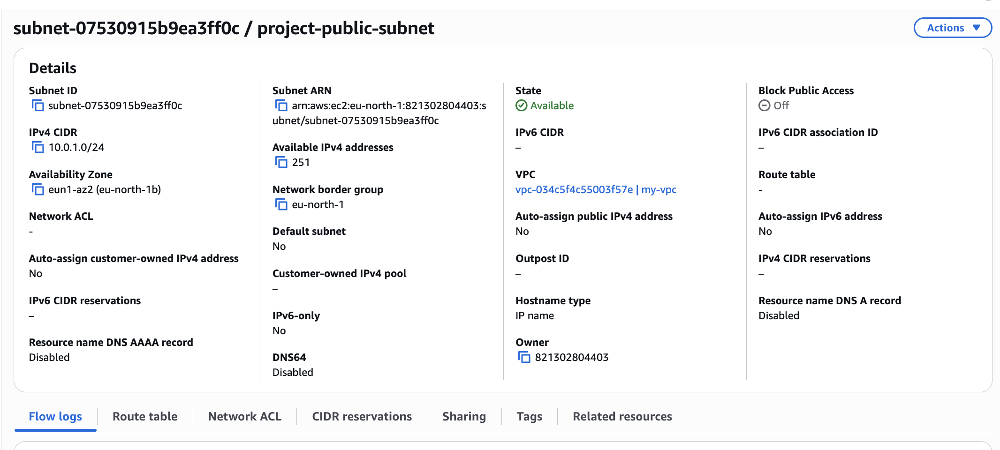

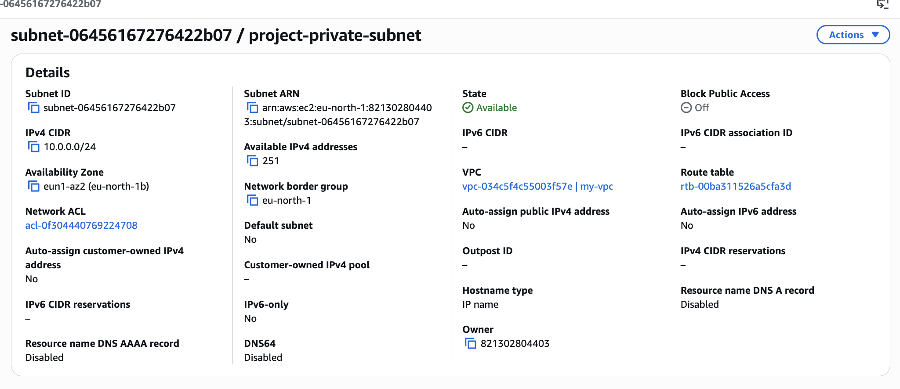

## 2. Creating and attaching the internet gateway

Next, I created an internet gateway and attached it to my VPC.

One thing I had to get clear was where it belongs. The internet gateway attaches to the VPC. It doesn't sit inside the public subnet.

Attaching it gives the VPC a way to connect to the internet, but I still needed to configure routing for the subnet that would use it.

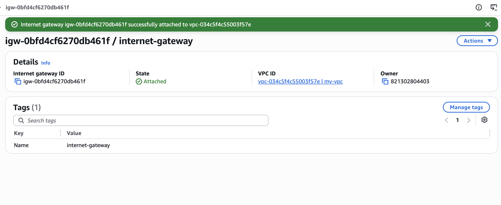

## 3. Setting up the public route table

I created a public route table with these routes:

| Destination   | Target           | What it does                                                             |
| ------------- | ---------------- | ------------------------------------------------------------------------ |
| `10.0.0.0/16` | Local            | Routes traffic within the VPC                                            |
| `0.0.0.0/0`   | Internet gateway | Provides a route for destinations that don't match a more specific route |

The local route is created automatically. It allows routing between resources in the VPC, including resources in different subnets. Security rules still need to allow the connection, however.

The `0.0.0.0/0` route catches IPv4 destinations that don't match a more specific route. In this table, its target was the internet gateway.

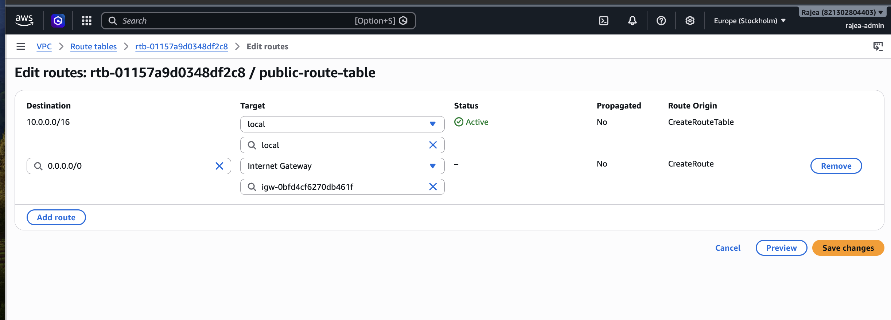

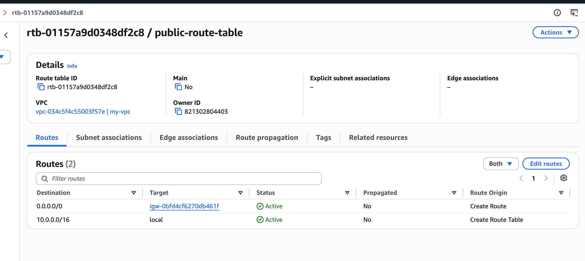

## 4. Setting up the NAT gateway and private routing

I also wanted the private instance to have a way to make outbound internet requests, such as downloading packages, without giving it a public IP address.

I initially created a regional NAT gateway, then deleted it and used a zonal NAT gateway for this setup. I placed it in the public subnet and allocated an Elastic IP address to it.

The private subnet's outbound route was configured to point to the NAT gateway:

| Destination   | Target      | What it does                                            |
| ------------- | ----------- | ------------------------------------------------------- |
| `10.0.0.0/16` | Local       | Routes traffic within the VPC                           |
| `0.0.0.0/0`   | NAT gateway | Sends outbound internet traffic through the NAT gateway |

The NAT gateway uses the public subnet's route to the internet gateway. It lets the private instance initiate internet connections and receive the replies, without allowing unsolicited inbound internet connections through the NAT gateway.

This also helped me separate the two gateways in my head: the zonal NAT gateway sits in the public subnet; the internet gateway attaches to the VPC.

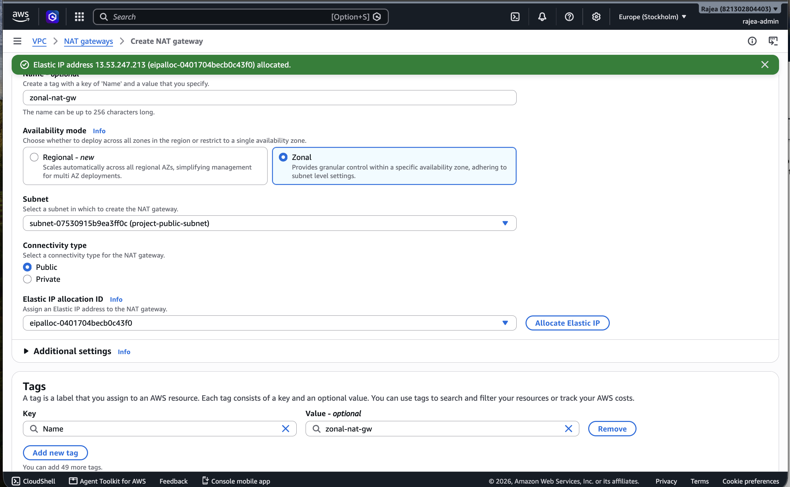

## 5. Launching the EC2 instances and installing Apache

I then launched an EC2 instance in each subnet: one public and one private.

The public instance would host my website and act as the bastion host for accessing the private instance.

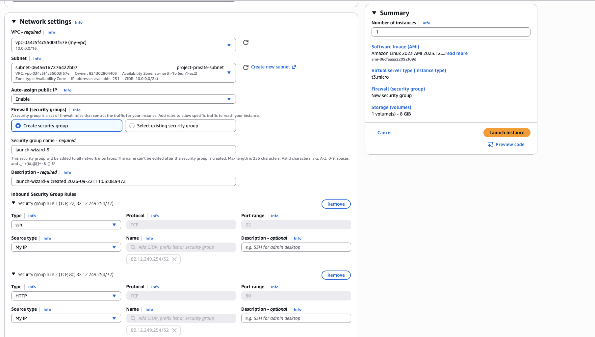

As the screenshot above shows, I initially launched the instance intended for the website in the private subnet. I corrected that placement later on.

I used SSH from my Mac to connect to the public instance. First, I restricted the key file's permissions with `chmod 400`, then used `ssh -i` to specify the key.

Run locally on the Mac:

```bash
chmod 400 /path/to/public-key.pem
ssh -i /path/to/public-key.pem ec2-user@PUBLIC_IP
```

On the public EC2 instance, I installed Apache so it could respond to HTTP browser requests and serve my website files.

Run on the public EC2 instance:

```bash
sudo dnf install -y httpd
sudo systemctl enable --now httpd
```

I placed the website files in `/var/www/html/`, with `index.html` as the main page, and used `scp` to upload an image from my Mac.

But unfortunately, the website still wouldn't load...

### The mistake that stopped my website loading

I went digging to find the source of the problem. I had added the HTML, CSS and JavaScript to `index.html`, so why wasn't the page loading?

My first step was to check the EC2 instance's `Security Group` settings to see if I had allowed SSH and HTTP access. Those settings turned out to be correct.

I then checked the VPC resource map to see which route tables and gateways the subnets were using.

Lo & behold, I found the bug!

Both subnets were still using the main route table, which at that point had its default route pointing to the NAT gateway.

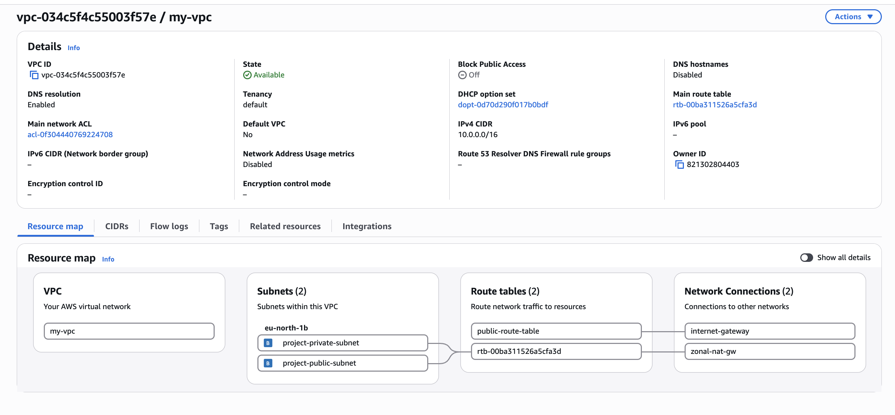

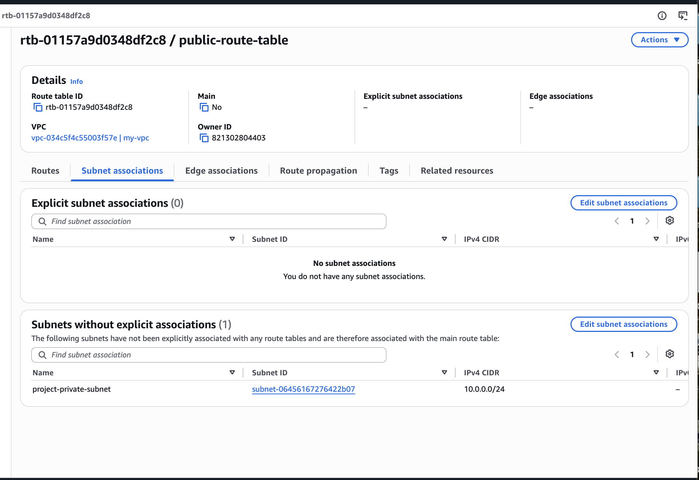

I had created the public route table and added the internet gateway route, but I had never explicitly associated that table with the public subnet.

So the route existed, but my public subnet wasn't using it.

I fixed this by opening the public route table, editing its subnet associations, selecting the public subnet and saving the association.

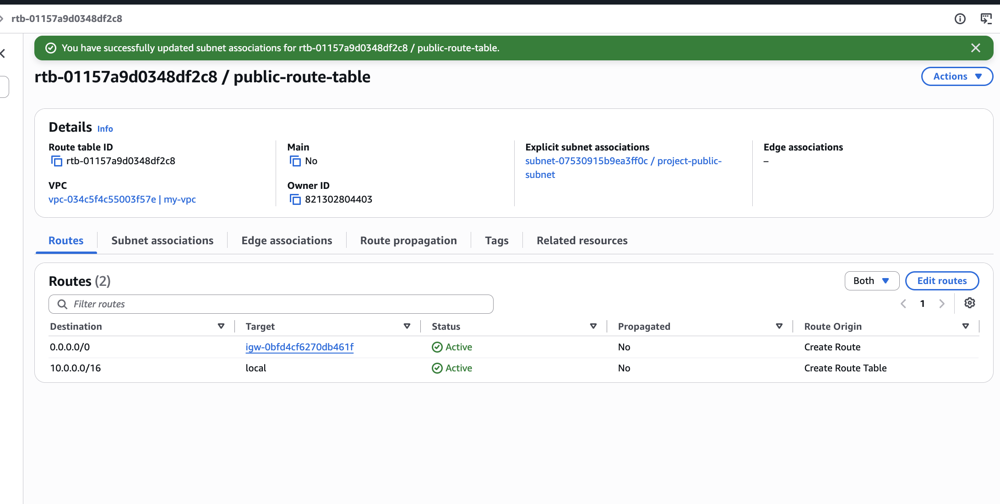

The VPC resource map then updated to show the correct connections between the subnets, route tables and gateways.

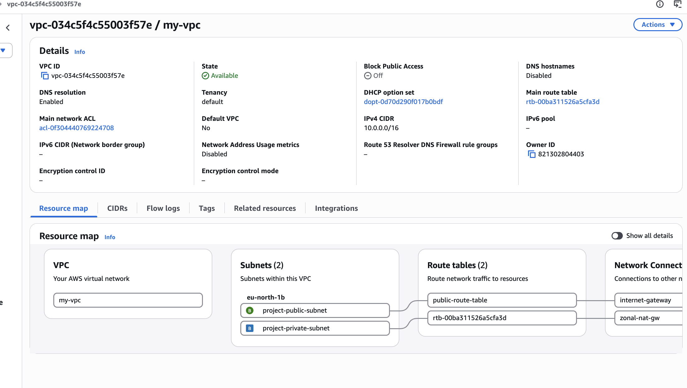

What clicked for me was that every subnet uses a route table. If I don't explicitly associate a different one, it uses the VPC's main route table automatically. Creating a new table doesn't switch the subnet over to it.

Also, calling a subnet 'public' doesn't make it public. It needs a route to an internet gateway. For my website to be reachable over IPv4, the EC2 instance also needed a public IP address, the correct security-group rules and a running web server.

## 6. Configuring the security groups

I used separate security groups for the two instances.

| Instance    | Inbound rule  | Source                                   |
| ----------- | ------------- | ---------------------------------------- |
| Public EC2  | HTTP, port 80 | Internet visitors (`0.0.0.0/0`)          |
| Public EC2  | SSH, port 22  | My public IP address (`/32`)             |
| Private EC2 | SSH, port 22  | The public EC2 instance's security group |

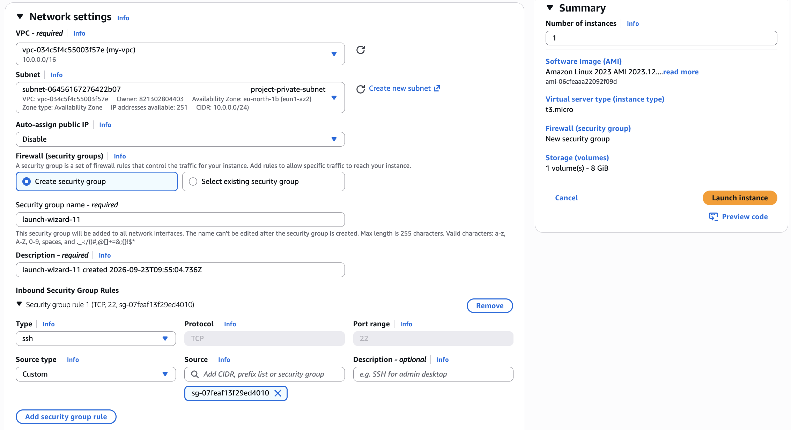

For the private instance, I used the public instance's security group as the SSH source. This allowed the public instance to be the entry point for the `bastion` setup.

I also got clearer on the difference between route tables and security groups: a route table tells traffic where to go, while a security group decides whether a connection is allowed.

## 7. Testing the website

Once the issues were resolved, I could open the website in my browser using the public instance's IP address over HTTP.

I developed the page to include information about me, what I built and an architecture diagram for the project.

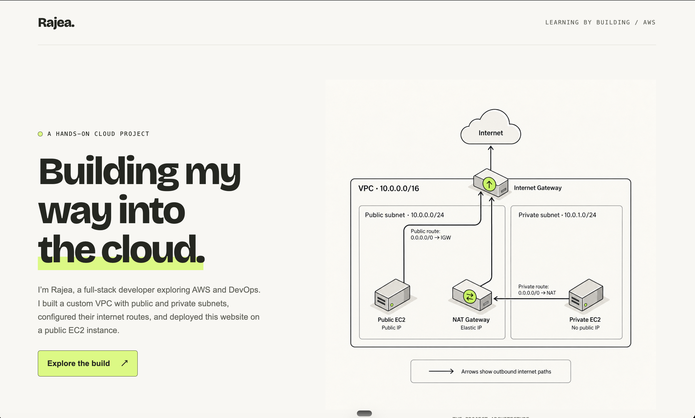

## 8. Working through the bastion setup

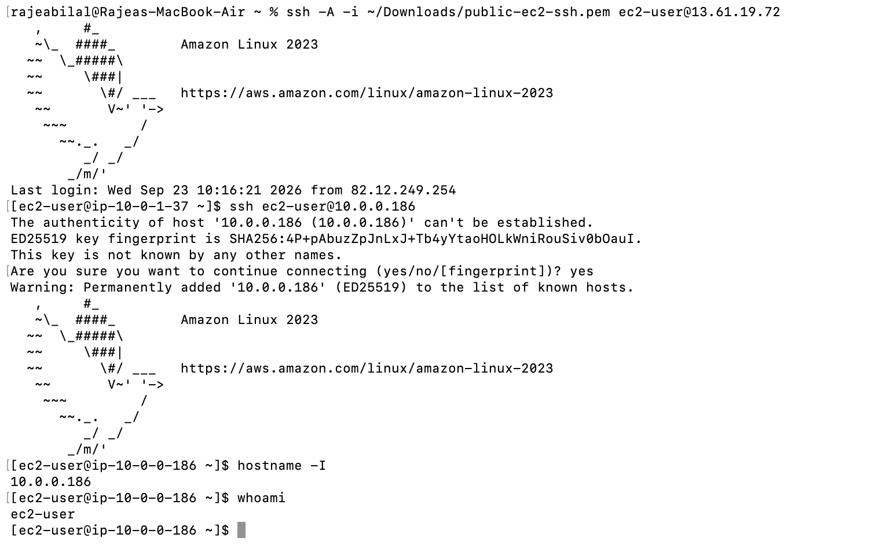

I used the public EC2 instance as the entry point for the bastion setup, so I could reach the private instance from inside the VPC.

The connection path was: my Mac connects to the public instance, then the public instance connects to the private instance using its private IP address.

I worked through SSH agent forwarding for this. The idea was to load the private instance's key on my Mac and forward access to the SSH agent, rather than copying the private key onto the public server.

Run locally on the Mac, with the SSH agent running:

```bash
chmod 400 /path/to/private-key.pem
ssh-add /path/to/private-key.pem
ssh -A -i /path/to/public-key.pem ec2-user@PUBLIC_IP
```

Then run from the public EC2 instance:

```bash
ssh ec2-user@PRIVATE_IP
```

After connecting to the private instance, I ran these commands to check where I was connected and which user I was logged in as:

```bash
hostname -I
whoami
```

`hostname -I` shows the instance's IP addresses, which helped me confirm I was on the private instance. `whoami` shows the logged-in user.

## 9. Connecting my custom domain to the website

Finally, I wanted a proper website address to share, instead of asking people to open a public IP address.

I used the `aws` subdomain under my own domain, giving the project the address `aws.rajeabilal.com`.

In Cloudflare, where I manage my domain's DNS, I added an `A` record pointing that subdomain to the public EC2 instance's public IPv4 address.

The record used these values:

| Field        | Value                                         |
| ------------ | --------------------------------------------- |
| Type         | `A`                                           |
| Name         | `aws`                                         |
| IPv4 address | The public EC2 instance's public IPv4 address |
| TTL          | Auto                                          |

The steps were to open my domain in Cloudflare, go to **DNS → Records**, choose **Add record**, enter those details and save.

The `aws` name creates the subdomain `aws.rajeabilal.com`. The A record tells DNS which IPv4 address that name points to. The website files still live on my EC2 instance, where Apache serves them.

For a direct DNS-only connection, the browser connects to that IP address. If Cloudflare proxying is enabled, visitors connect through Cloudflare, which forwards requests to the EC2 instance.

One thing to keep in mind: an automatically assigned EC2 public IPv4 address can change if I stop and start the instance. If that happens, I need to update the A record. An Elastic IP associated with the public EC2 instance would keep the address stable; the Elastic IP used by my NAT gateway is separate.

Creating the DNS record also doesn't configure HTTPS on Apache. DNS points the name to the server; HTTPS needs its own certificate and configuration, or a suitable Cloudflare setup.

That gave me a much clearer link to share for the project: [aws.rajeabilal.com](https://aws.rajeabilal.com/).

## What I learned

- A subnet's name doesn't determine whether it's public or private. Its routing does.
- An internet gateway attached to the VPC isn't enough on its own. The public subnet must use a route table with a route to it.
- A subnet uses the main route table unless I explicitly associate another one.
- “Main” describes the table's default association role. Its routes can be changed; it isn't permanently an internal-only table.
- The local route covers routing within the VPC, including between subnets. Security rules still apply.
- Route tables, public IP addresses, security groups and the web server all need to be configured correctly for the website to load.
- The NAT gateway provides outbound internet access for private resources without giving those instances public IP addresses.
- An A record connects a domain or subdomain name to an IPv4 address.
- Fixing one issue doesn't always fix the whole connection. I had to check each part of the setup.

The route-table mistake was probably the most useful part of this project for me. I could see all the resources in the console, but I had to understand how they were connected to work out why the website wasn't loading.
