# Serverless Student API — Lambda, API Gateway and DynamoDB

My goal was to build one full end-to-end flow of an API request, from the client to the backend and all the way back.

I wanted to understand which AWS services a request comes into contact with, how they connect to each other, and what permissions are needed for the flow to work. I also ran into a few errors along the way!

The API has two methods: one to save a student and another to retrieve the students already stored in the database. I also added API keys, a usage plan and AWS WAF rate limiting, then tested the flow in Postman.

## What I built

| Part                      | What it does                                                                              |
| ------------------------- | ----------------------------------------------------------------------------------------- |
| API Gateway REST API      | Receives the client's request and invokes the matching Lambda function.                   |
| `addStudent` Lambda       | Creates a student record and writes it to DynamoDB.                                       |
| `getAllStudents` Lambda   | Reads the student records from DynamoDB.                                                  |
| DynamoDB `students` table | Stores the student records.                                                               |
| IAM roles and policies    | Give each Lambda permission to carry out its work.                                        |
| API keys and usage plan   | Identify the calling application and apply usage limits.                                  |
| AWS WAF                   | Checks incoming traffic and blocks requests when a source IP exceeds the configured rate. |
| Postman                   | Sends requests so I can test the whole flow.                                              |

The functions use JavaScript, Node.js and AWS SDK v3. I used the Stockholm region, `eu-north-1`, for this build.

**Build details:** this version uses an API Gateway **REST API**, with **Lambda proxy integration switched off**. WAF was configured and tested, then removed after testing to avoid ongoing costs. A custom domain and ACM certificate were discussed as possible additions but were not completed in this walkthrough.

## 1. Drawing the architecture first

I started by making an architectural drawing. This is a step I've decided to include in my projects because it helps me map out the flow before I start configuring the services.

For a POST request, Postman sends the student data to API Gateway. API Gateway invokes `addStudent`, which writes the record to DynamoDB and returns a response.

For a GET request, API Gateway invokes `getAllStudents`, which reads the records from DynamoDB and sends them back to the client.

When WAF was attached, it checked requests before they reached the API's backend. Each Lambda also needed an execution role giving it permission to access the table.

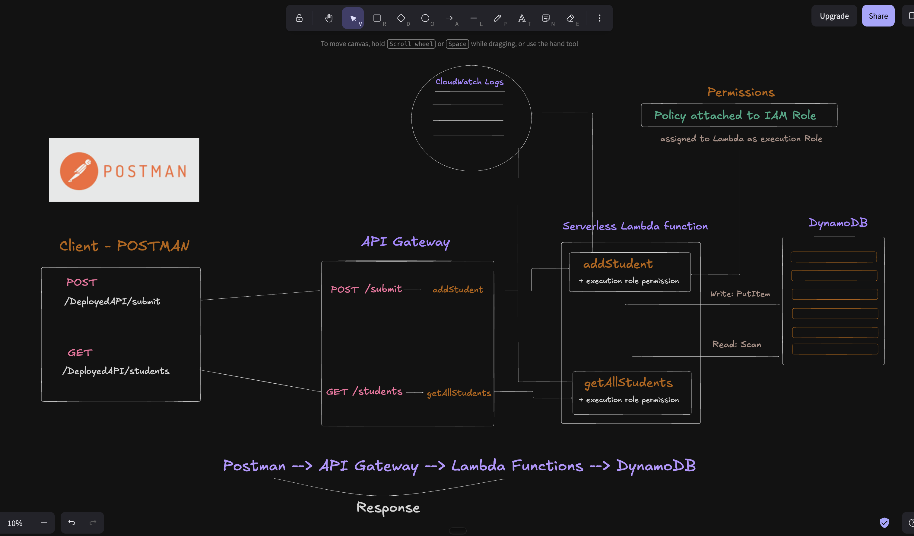

## 2. Creating the DynamoDB table

I created a DynamoDB table called `students`.

The table name is simply `students`. `/students` is the API resource path; it isn't the name of the database table.

Each record uses an `id` as its identifier. In the Lambda code, I generate this with `randomUUID()` so each student gets a unique ID. The table's key configuration needs to match the item written by the function: an `id` partition key with a String type for this example.

The saved record contains:

```json
{
  "id": "generated-unique-id",
  "studentName": "Rajea",
  "module": "AWS",
  "timestamp": "2026-10-03T07:49:10.711Z"
}
```

The timestamp comes from `new Date().toISOString()`. It gives me a consistent date and time in UTC, stored as a string.


## 3. Setting up API Gateway and testing the first connection

I created a REST API called `studentsAPI` and configured a POST method. In the final version of this build, the POST resource is `/submit`.

A resource is the path the client calls. The method tells API Gateway what kind of request it is. So `POST /submit` means: when a POST request arrives at this path, use the integration configured for that method.

I connected the method to a Lambda function. I first wanted to check that API Gateway could invoke Lambda and return a response before adding the database write.

This helped me test one part of the flow at a time. A successful response at this point proved the API-to-Lambda connection worked; it didn't yet prove that anything had been saved to DynamoDB.

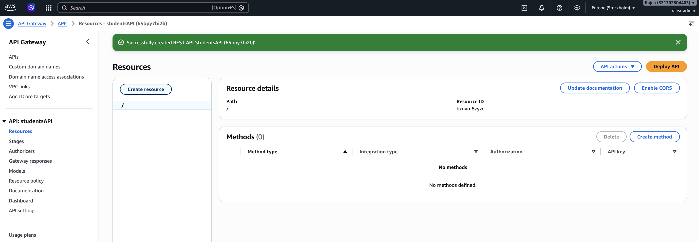

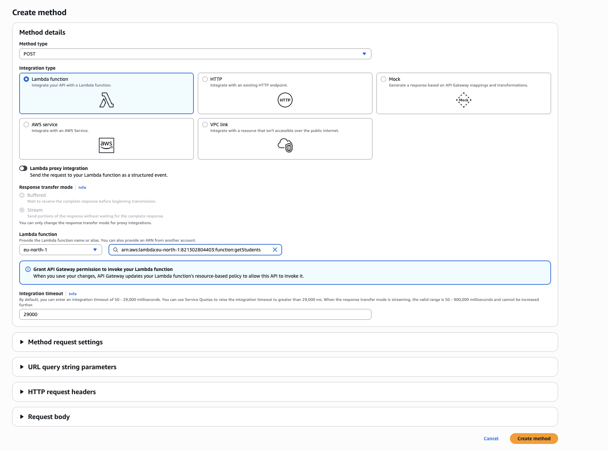

## 4. Giving Lambda permission to use DynamoDB

The next piece was permissions. Connecting the services wasn't enough: Lambda also needed permission to write to the table.

This is where IAM policies, roles and execution roles fit in:

- A **policy** describes which actions are allowed and on which resources.
- An **IAM role** has policies attached to it.
- A **Lambda execution role** is the IAM role that Lambda uses when the function runs.

An execution role isn't a separate type of service I need to create after an IAM role. It's the role assigned to the function for its runtime permissions.

For the write function, the relevant DynamoDB action is `dynamodb:PutItem`. For the read function shown below, it is `dynamodb:Scan`. The policy's resource should point to the `students` table ARN.

CloudWatch logging permissions allow the functions to write logs, which are useful when a request fails. These can be provided by the usual Lambda basic execution policy alongside the table permissions.

I selected the appropriate role under each function's **Configuration → Permissions**. The important check was that the policy was attached to the role the function was actually using.

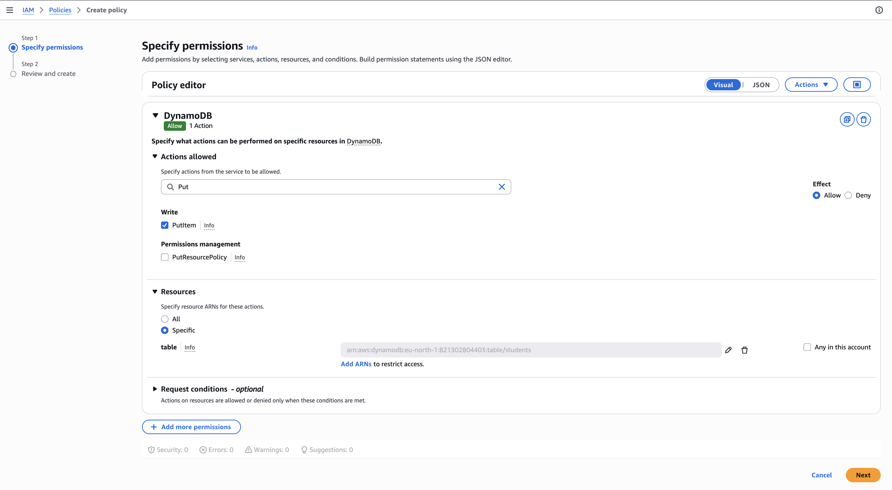
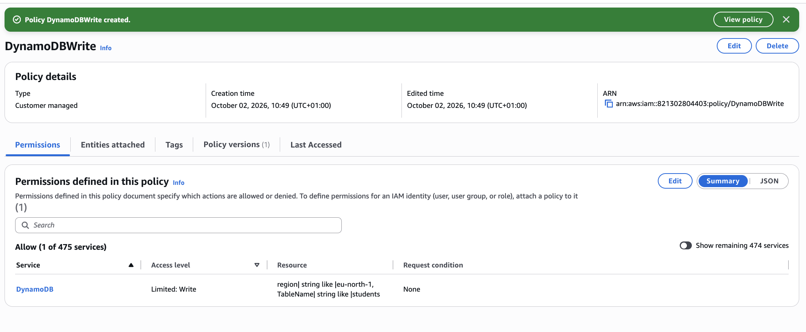

## 5. Writing the addStudent function

I updated the POST Lambda so it could receive the student data, create a record and save it to DynamoDB.

The main pieces of the code are:

```js
import { DynamoDBClient } from "@aws-sdk/client-dynamodb";
import { DynamoDBDocumentClient, PutCommand } from "@aws-sdk/lib-dynamodb";
import { randomUUID } from "node:crypto";

const client = new DynamoDBClient({});
const docClient = DynamoDBDocumentClient.from(client);

export async function addStudent(event) {
  try {
    const student = {
      id: randomUUID(),
      studentName: event.name,
      module: event.module,
      timestamp: new Date().toISOString(),
    };

    const command = new PutCommand({
      TableName: "students",
      Item: student,
    });

    await docClient.send(command);

    return {
      message: "Student saved successfully",
      student,
    };
  } catch (error) {
    console.error("Failed to save student:", error);
    return { message: error.message };
  }
}
```

This is a cleaned-up example of the flow developed during the build. It doesn't include input validation yet.

1. `DynamoDBClient` sets up communication with DynamoDB.
2. `DynamoDBDocumentClient` lets me work with normal JavaScript objects, handling DynamoDB's data format when reading and writing.
3. `event` contains the data Lambda receives from API Gateway.
4. `PutCommand` describes the item I want to save and the table to save it in.
5. `await docClient.send(command)` sends the write request and waits for it to finish.
6. The function returns the saved student details to the client.

Because proxy integration is off and this build passes the JSON request through directly, I read `event.name` and `event.module`. With proxy integration on, the request normally arrives inside `event.body`, which would need parsing first. The code must match the integration configuration.

For a file named `index.mjs`, the Lambda handler setting needs to match the exported function: `index.addStudent`.

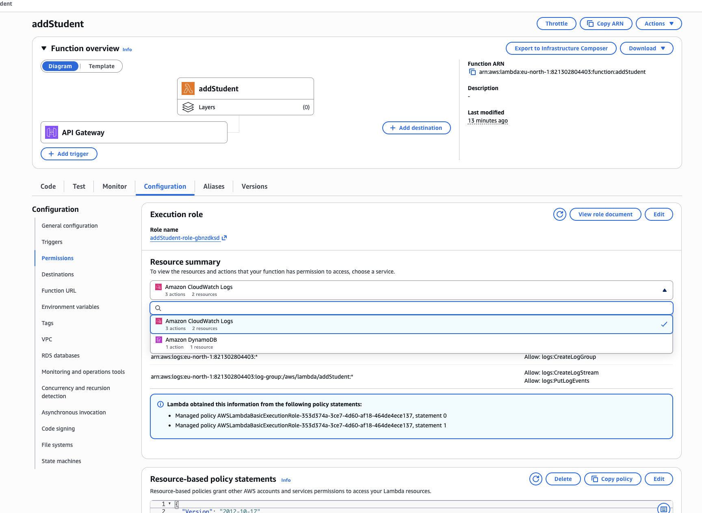

## 6. Deploying the API and testing POST in Postman

I deployed the API to a stage called `DeployedAPI`.

A stage is a named place where a deployed version of the API is available. Postman calls the deployed stage, so changes to API methods and their settings need to be deployed there before I test them through the endpoint.

The endpoint follows this format:

```text
https://<api-id>.execute-api.eu-north-1.amazonaws.com/DeployedAPI/submit
```

In Postman, I selected **POST**, entered the endpoint and used **Body → raw → JSON**:

```json
{
  "name": "Rajea",
  "module": "AWS"
}
```

I sent the request and checked both the response and the DynamoDB table. Seeing the new item in the table confirmed the full write flow worked.

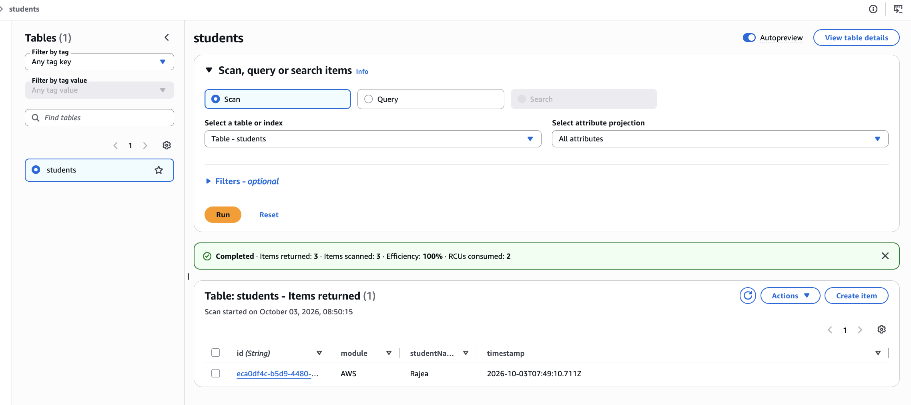

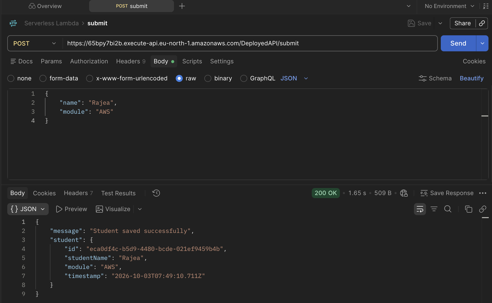

## 7. Adding GET to retrieve the students

Once I could save records, I added a second function called `getAllStudents` and connected it to **GET `/students`**.

This function uses a scan to read the table. DynamoDB can return the results in pages, so I used `paginateScan` to keep requesting the next page rather than only returning the first one.

```js
import { DynamoDBClient } from "@aws-sdk/client-dynamodb";
import { DynamoDBDocumentClient, paginateScan } from "@aws-sdk/lib-dynamodb";

const client = new DynamoDBClient({});
const docClient = DynamoDBDocumentClient.from(client);

export async function getAllStudents() {
  try {
    const paginator = paginateScan(
      { client: docClient },
      { TableName: "students", Limit: 100 },
    );

    const allStudents = [];

    for await (const page of paginator) {
      allStudents.push(...(page.Items ?? []));
    }

    return {
      statusCode: 200,
      body: allStudents,
    };
  } catch (error) {
    console.error("Failed to retrieve students:", error);
    return {
      statusCode: 500,
      body: { message: error.message },
    };
  }
}
```

The handler for this export is `index.getAllStudents` when the file is `index.mjs`.

`Limit: 100` applies to each scan request; it isn't a limit of 100 students for the whole function. The paginator continues through the available pages.

This line took me a little while to understand:

```js
allStudents.push(...(page.Items ?? []));
```

It means: take the students from this page and add them individually to my `allStudents` array. If `page.Items` is missing, use an empty array instead.

I assigned the read function a role with permission to scan the table, configured the GET integration and deployed the API changes.

The GET endpoint follows this format:

```text
https://<api-id>.execute-api.eu-north-1.amazonaws.com/DeployedAPI/students
```

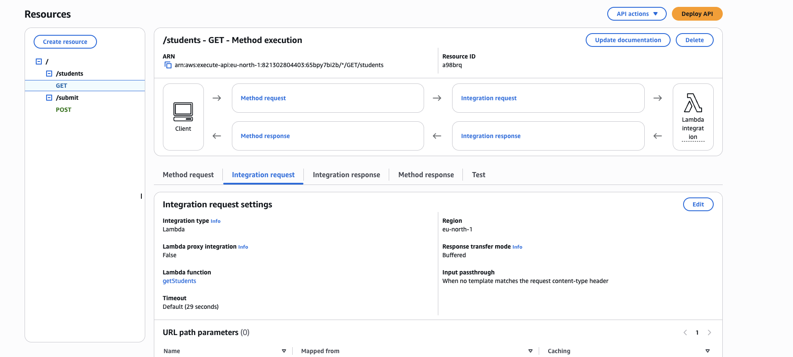

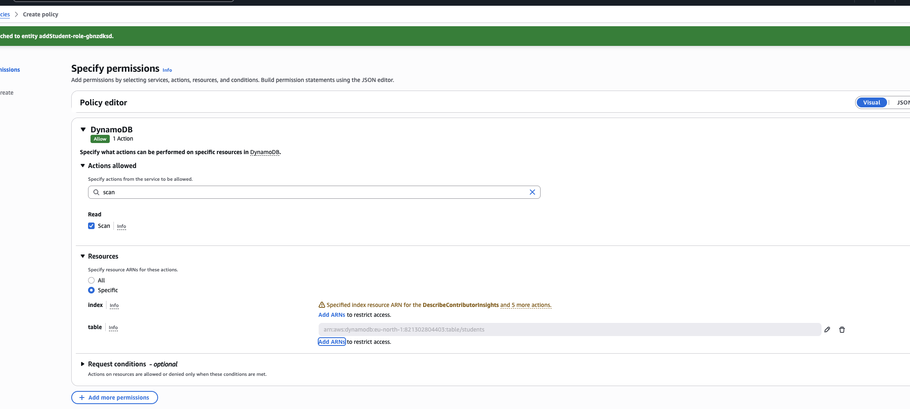
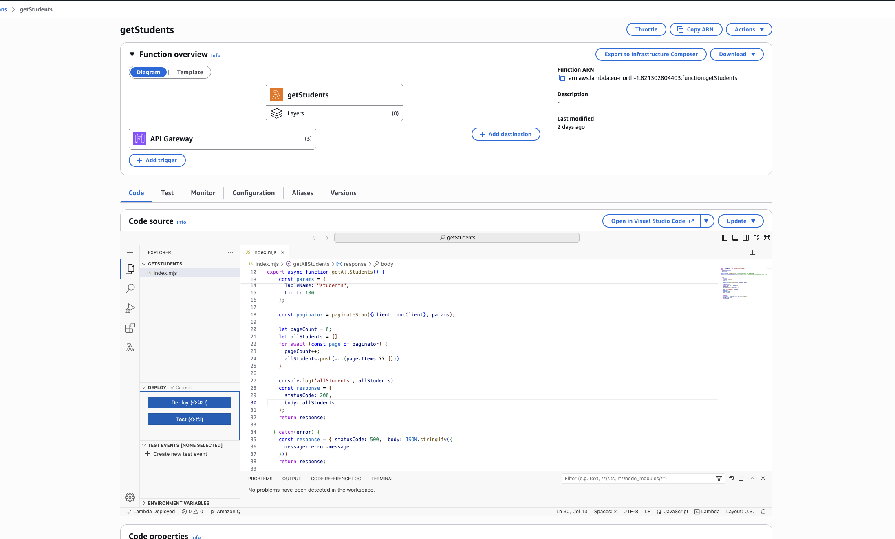

## 8. Understanding the response format

At one point, the response worked but looked awful: the student array was inside a string with lots of backslashes.

That happened because I used `JSON.stringify(allStudents)` and returned it inside another JSON object. With the non-proxy setup passing that object back, Postman displayed the `body` as a string instead of an array.

For this build, returning `body: allStudents` gave me a readable array in the response.

There is an important detail here: **with proxy integration off, a `statusCode` field inside the returned object is just data unless API Gateway is configured to map it to the HTTP response status.** Returning `{ statusCode: 500 }` doesn't automatically make Postman receive HTTP 500. I saw HTTP 200 responses containing Lambda errors during troubleshooting.

With proxy integration on, API Gateway expects the proxy response structure, including a string `body`. That's why `JSON.stringify()` belongs there. With proxy integration off, the request and response mappings determine the format.

The GET example above preserves the response envelope used during my build. Configuring proper HTTP error mappings is an improvement I would make next.

## 9. Adding API keys and a usage plan

After testing the basic flow, I created an API key and a usage plan.

My usage plan was called `API_usage`, with these settings:

| Setting              | Value used in this build    |
| -------------------- | --------------------------- |
| Rate                 | 2 requests per second       |
| Burst                | 5 requests                  |
| Quota                | 500 requests per month      |
| Associated API stage | `studentsAPI → DeployedAPI` |

I attached the API key to the usage plan and enabled **API Key Required** on the GET method. I also needed the same setting on POST to require the key for both methods, followed by redeploying the API changes.

There are three connections to check: the key belongs to the usage plan, the usage plan includes the deployed API stage, and the method requires a key.

To test it in Postman, I added this under **Headers**:

| Key         | Value            |
| ----------- | ---------------- |
| `x-api-key` | `<your-api-key>` |

The header needs to be enabled. I kept the real value out of this README.

API keys identify the calling application and help track its usage. They aren't a replacement for a user login or proper authentication. Usage-plan limits are also approximate, rather than guaranteed hard cut-offs.

<!-- Add the usage plan, associated stage and Postman header screenshots here. Hide the key value. -->
<!--  -->
<!--  -->

## 10. Adding AWS WAF rate limiting

I then added AWS WAF to test another layer of protection.

In simple terms, WAF checks incoming web requests against rules. My rule looked for too many requests coming from the same source IP address in a short period of time.

The AWS console called the web ACL a **Protection pack (web ACL)**. I created one called `students-api-protection` in the same region as the API and associated it with **studentsAPI → DeployedAPI**.

WAF attaches to the stage, so I didn't need to attach it separately to GET and POST.

I added a custom rate-based rule called `limit-requests-per-ip`:

| Setting                | Initial value     |
| ---------------------- | ----------------- |
| Rate limit             | 100 requests      |
| Evaluation window      | 5 minutes         |
| Request aggregation    | Source IP address |
| Rule action            | Block             |
| Web ACL default action | Allow             |

The intention was to allow ordinary traffic, then block further requests from an IP when WAF detected that its rate exceeded the limit.

The difference from the usage plan is that the usage plan tracks requests using the API key, while this WAF rule groups requests by their source IP address.

<!-- Add the WAF stage association and rate-rule settings screenshots here. -->
<!--  -->
<!--  -->

## 11. Testing WAF with the Postman Collection Runner

I put the requests in a collection called `Serverless Lambda` and opened **Run collection**.

For the rate-limit test, I selected only **GET `/students`**. I left POST unchecked so the test wouldn't keep creating student records.

My first test used 150 iterations and a 1,000 ms delay. The delay means Postman waits between requests; the response time and runner overhead also add to the total run time.

The requests were still being allowed after iteration 100. One screenshot showed about 120 requests over nearly nine minutes. That didn't prove WAF was broken: my rule checked the recent five-minute window, not the total requests since I clicked Run.

I temporarily lowered the rule to **20 requests per 5 minutes** and ran **50 GET requests** to make the test easier to observe.

Another useful discovery was that Postman was using its **Cloud Agent**. The WAF sampled requests showed two different source IP addresses. Cloud Agent sends requests through Postman's cloud servers, which don't have a guaranteed fixed IP. My WAF rule counted each source IP separately.

For a clearer test, I switched to sending requests locally through the Desktop Agent. The Desktop Agent or desktop app sends requests through my computer's network rather than Postman's cloud servers.

<!-- Add your runner settings and results screenshots here. -->
<!--  -->
<!--  -->

### Checking the result in WAF

I opened the WAF dashboard, refreshed the summary and checked the sampled requests.

The sampled request showed:

| Detail                                    | Observed result            |
| ----------------------------------------- | -------------------------- |
| Rule                                      | `limit-requests-per-ip`    |
| Resource path                             | `/DeployedAPI/students`    |
| Action                                    | `BLOCK`                    |
| Time of the first confirmed sampled block | 11:46:34 on 5 October 2026 |

This was the evidence I needed: it named the rule that actually blocked the request.

A later dashboard screenshot, filtered to **Last 5 minutes**, showed **50 total requests, 43 allowed and 7 blocked**.

WAF's rate checking is approximate. It doesn't guarantee that the very next request after the limit is exceeded will be blocked, so a limit of 20 doesn't mean exactly 20 allowed and 30 blocked in a 50-request test.

Full WAF logging was not enabled in this build. I used dashboard metrics and sampled requests to check the result.

<!-- Add your confirmed BLOCK row and 50/43/7 summary screenshots here. -->
<!--  -->
<!--  -->

## 12. Removing WAF after testing

Once I had tested WAF and saved the evidence, I removed it to keep the costs of this practice project down.

I opened **Manage resources**, removed the association with **studentsAPI → DeployedAPI**, then deleted `students-api-protection` from the protection packs list.

Detaching the API alone leaves the web ACL and its rule in place, so I also needed to delete the protection pack to stop those ongoing WAF resource charges. Removing WAF doesn't remove the API, Lambda functions, DynamoDB table or API keys.

**WAF was part of the completed test, but is not intended to remain active on this practice API.** Other AWS resources can still incur charges while they remain in use.

<!-- Add your WAF cleanup confirmation screenshot here, if available. -->
<!--  -->

## What I learnt

The most useful part of this project was understanding the connections between the services rather than just creating them in the console.

- A Lambda function needs the correct permissions as well as working code.
- The execution role is the role Lambda uses while it runs.
- API Gateway matches a resource and method to an integration.
- The Lambda code needs to match whether proxy integration is on or off.
- A successful API-to-Lambda test doesn't automatically mean the database write worked.
- A paginator helps me read all the pages of a DynamoDB scan.
- An API key needs a usage plan with the correct API stage attached.
- A WAF rate limit is based on its evaluation window and grouping settings, not the dashboard's total request count.
- Postman's sending agent can change which source IP AWS sees.
- Testing a feature and then cleaning up the paid resources is part of completing the project.

## A logical order for rebuilding it

During this build I moved between API Gateway, Lambda and permissions as I tested each connection. If I rebuild it again, this is the order I would follow:

1. Draw the flow and decide the request and response shapes.
2. Create the DynamoDB table.
3. Create the table policies and Lambda execution roles.
4. Create the write Lambda and test it with a sample event.
5. Create the read Lambda and test it against the saved records.
6. Create the REST API resources and methods, then connect the Lambdas.
7. Deploy the API to a stage and test POST and GET in Postman.
8. Add the API key and usage plan, associate the stage and redeploy method changes.
9. Add WAF, associate the stage and test the rate rule.
10. Save the screenshots, document the results and remove resources I don't need to keep running.

Creating the table and roles early gives the functions the things they depend on. Testing each function before adding API Gateway also makes it easier to tell where an error is coming from.

## Errors and troubleshooting

### `DynamoDBDocumentClient.from is not a constructor`

I used `new` with `DynamoDBDocumentClient.from()`.

```js
// Incorrect
const docClient = new DynamoDBDocumentClient.from(client);

// Correct
const docClient = DynamoDBDocumentClient.from(client);
```

`from()` is a method that creates the document client from the existing client. I call it directly.

imported `paginateScan` instead. I needed to import `PutCommand` from `@aws-sdk/lib-dynamodb`.

### `event` wasn't available in the write function

I was trying to read `event.name` and `event.module`, but the function didn't accept `event` as a parameter.

```js
export async function addStudent(event) {
  // event is available here
}
```

### `page is not defined`

The GET loop used `page` without declaring it. The fix was:

```js
for await (const page of paginator) {
  allStudents.push(...(page.Items ?? []));
}
```

This error came from the scan code. When an error doesn't match the function I'm looking at, I need to check the integrated Lambda, its handler and the deployed code rather than assume it came from the POST function.

### The GET response contained nested arrays

I first used:

```js
allStudents.push(...[page.Items]);
```

That adds the page's whole array as one item. I wanted the students themselves added individually, so I changed it to:

```js
allStudents.push(...(page.Items ?? []));
```

### The response had escaped quotes and backslashes

I had stringified the student array inside the response object. For this non-proxy response, returning the array directly kept it readable. Proxy integration uses a different response contract and needs a string body.

### An error response wasn't easy to read

`JSON.stringify(error)` doesn't reliably include the useful Error properties. Returning an object containing `error.message` made the message visible, while `console.error(error)` helped keep the full details in the logs.

### API Gateway showed HTTP 200 with a Lambda error in the body

The method test returned HTTP 200 even when Lambda returned an error, including the document-client constructor error. With proxy integration off, API Gateway controls the HTTP response through its integration and method response configuration. I couldn't use HTTP 200 alone as proof the backend operation succeeded.

### Postman appeared to hang

At one point, Postman kept waiting and I couldn't cancel the request normally. I used the API Gateway method test and its execution logs to inspect the Lambda invocation separately. Those logs exposed concrete code errors that I could fix.

The chat didn't establish one definite cause for the Postman freeze itself, so I haven't attributed it to a specific AWS setting.

### The API key request returned `403 Forbidden`

The key was attached to the usage plan, but the plan was missing the deployed API stage. Adding **studentsAPI → DeployedAPI** to the usage plan resolved the issue.

I also checked that the key was enabled, `x-api-key` was sent in Postman, the method required the key and the API method changes had been deployed.

### Finding and creating the WAF web ACL was confusing

The console used the name **Protection pack (web ACL)** and offered recommended configurations as well as custom options. I used a custom rate-based rule and associated the regional API stage through resource management.

There were several attempts during setup, but the available chat doesn't establish a precise error message for every failed creation attempt. The final working configuration is documented above.

### More than 100 iterations ran, but requests were still allowed

The iteration count was the total for the run. WAF checked the recent five-minute window separately for each source IP. The long first run and the Cloud Agent's multiple source IPs made the test harder to interpret.

I reduced the threshold temporarily and checked the actual matching rule in sampled requests. That confirmed blocking.

### Postman said `No tests found`

This meant I hadn't added automated test scripts to the requests. It didn't mean Postman hadn't sent them. I could still inspect each HTTP response and check the WAF results.

### The WAF summary seemed stuck

The summary initially covered **Last 3 hours**, so old requests were still included. Refreshing updates the figures; it doesn't reset them. Selecting **Last 5 minutes** made the recent test easier to see.

### Delete protection pack was greyed out

I needed to remove the associated API stage first. After disassociating it through **Manage resources**, I could delete the protection pack.
