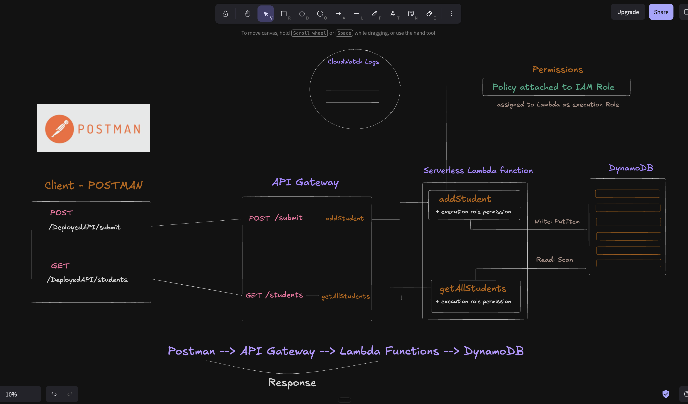
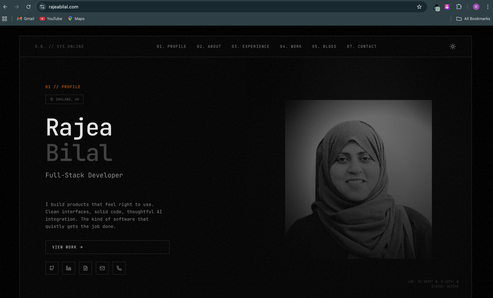

# DevOps Learning Journey

Notes, scripts, and projects from learning DevOps from the ground up — starting with the shell and Linux fundamentals, then networking, Git, Docker, AWS, and now infrastructure as code.

Everything here is written by me as I learn it. The goal is to explain concepts in plain language rather than collect commands I don't understand.

**Currently learning:** Terraform — providers, modules, state, and remote backends.

---

## Featured project — Serverless Student API on AWS

I built one API request's full journey end to end: from Postman, through API Gateway, into a Lambda function, to a DynamoDB table and back. The goal was to understand which services a request touches, how they connect, and which permissions each one needs.



**Stack:** API Gateway (REST) · AWS Lambda (Node.js, SDK v3) · DynamoDB · IAM · API keys and usage plans · AWS WAF · Postman

What it involved: two Lambda functions (`POST /submit` saves a student, `GET /students` reads them all with a paginated scan), a least-privilege IAM policy per function, deploying to a stage, adding an API key with a usage plan, and a WAF rate-based rule that blocks an IP sending too many requests.

**What I learnt the hard way:** working code isn't enough without the right execution role, and with Lambda proxy integration off, an HTTP 200 doesn't prove the backend succeeded. Testing WAF also showed that Postman's Cloud Agent sends from changing IPs, which splits per-IP rate limits. WAF was removed after testing to avoid ongoing costs.

**→ [Full write-up, step by step with screenshots](AWS/Projects/Serverless_API_Lambda/build_process.md)**

---

## Earlier project — Deploying a site to AWS EC2 by hand

I took my Next.js portfolio off Vercel and deployed it to a Linux server I configured and secured myself, to find out what managed hosting had been doing on my behalf.



**Stack:** AWS EC2 (Ubuntu) · NGINX · Cloudflare DNS · Certbot + Let's Encrypt

What it involved: opening the right ports via Security Group firewall rules, understanding NGINX's `sites-available` / `sites-enabled` symlink model, serving a static build from `/var/www`, issuing and deploying a TLS certificate, and repointing DNS to the EC2 public IP.

**Where it ended up:** the portfolio is back on Vercel today, and that's the most useful thing this project taught me. Serving a static export by hand meant every content change was a manual rebuild, re-upload, and reload on the server. There was no path from "commit" to "live" that didn't involve me SSH-ing in. That gap is precisely what CI/CD pipelines exist to close, and hitting it deliberately is why it's next on my list. The server work did its job: I now know what Vercel is automating for me.

**→ [Full write-up, step by step with screenshots](Networking/Deployment_project/README.md)**

---

## Modules

| Module | What it covers | Status |
| --- | --- | --- |
| [Bash](Bash/) | Shell scripting — variables, loops, conditionals, functions, argument parsing, error handling, file I/O | Scripts complete |
| [Linux](Linux/) | Permissions, root and sudo, processes, text processing, plus 13 OverTheWire Bandit levels | Notes complete |
| [Networking](Networking/) | Ports and protocols, TCP vs UDP, the OSI model, and the EC2 deployment project | In progress |
| [Git](Git/) | Branching, rebasing, undoing changes, stashing, hooks, remotes, secrets, Git at scale | Notes complete |
| [Docker](Docker/) | Images, Dockerfiles, multi-stage builds, volumes, networking, Compose, pushing to Docker Hub and Amazon ECR | Complete |
| [AWS](AWS/) | IAM, EC2, storage, load balancers, containers (ECS/EKS), VPC networking, Route 53, serverless — plus two projects | Complete |
| [Terraform](Terraform/) | Providers, an EC2 module, `moved` blocks, and remote state in S3 | In progress |

### Projects

| Area | Project | What it shows |
| --- | --- | --- |
| Bash | [Bash – The Game](Bash/README.md#bash--the-game) | A ten-level scripting challenge series, from loops and conditionals to a directory-change monitor |
| Networking | [EC2 deployment](Networking/Deployment_project/README.md) | A Next.js site served by NGINX on EC2, with HTTPS and Cloudflare DNS |
| Docker | [First Flask container](Docker/flask_app/README.md) | Containerising a small Flask app, and the six problems I hit along the way |
| Docker | [Flask + MySQL](Docker/Guide/flask_app_sqldb.md) | Two containers on a custom network, finding each other by name |
| Docker | [Flask + Redis with Docker Compose](Docker/Challenge/flask_redis_app/README.md) | Multi-container app with a Redis visit counter, persisted volumes, and NGINX load balancing across Flask replicas |
| AWS | [Custom VPC](AWS/Projects/Custom_network/build_process.md) | A VPC with public and private subnets, route tables, an internet gateway, and EC2 instances in each |
| AWS | [Serverless Student API](AWS/Projects/Serverless_API_Lambda/build_process.md) | API Gateway → Lambda → DynamoDB, with IAM, API keys, usage plans, and WAF rate limiting |
| Terraform | [EC2 module](Terraform/Terraform_Registry/) | An EC2 instance moved into a reusable module with a `moved` block, and state migrated to an S3 backend |

---

## How this went

**December 2025 — Linux and the shell.** Started with how Linux thinks about ownership and permissions, then root vs. sudo, processes, and text processing with `grep`, `awk`, and `sed`. Worked through the OverTheWire Bandit wargame alongside it, writing up each level's reasoning rather than just the password.

**December 2025 – January 2026 — Bash.** Built a ten-level "Bash game" for myself, each level a script solving a progressively harder problem: looping over files, conditionals, argument parsing, a file sorter, a multi-file log searcher, and a directory-change monitor. Two boss levels combining everything.

**January 2026 — Networking.** Ports, protocols, TCP vs UDP, and the OSI model. Finished the module by deploying my portfolio to EC2 with NGINX and HTTPS, which made DNS and firewall rules concrete in a way notes hadn't.

**January 2026 — Git.** Beyond `add`/`commit`/`push` into what teams actually rely on: rebase vs. merge, recovering work with reflog, commit hygiene, pre-commit hooks, and handling secrets that shouldn't have been committed.

**August 2026 — Docker.** Images, Dockerfiles, Compose, and registries. Built a Flask app backed by MySQL, then a multi-container Flask + Redis app load-balanced by NGINX and made production-ready with Gunicorn and restart policies.

**September – October 2026 — AWS.** Worked through IAM, EC2, storage, load balancers, containers, VPC networking, and Route 53. Built a custom VPC by hand, then a serverless API with Lambda, DynamoDB, API keys, and WAF.

**Now — Terraform.** Turning the infrastructure I built by hand into code: an EC2 module, refactoring with `moved` blocks, and moving state to an S3 backend.

---

## Repository structure

```
.
├── Bash/                        # Shell scripting practice
│   ├── Bash - The Game/         #   10-level self-built challenge series
│   ├── Bash Challenges/         #   Standalone problems
│   ├── Loops&FlowControl/
│   ├── Functions/
│   ├── Error_Handling/
│   └── Reading_Files/
├── Linux/                       # Linux fundamentals
│   ├── linux-notes*.md          #   Permissions, root, text processing
│   ├── linux-commands.md        #   Command reference
│   └── OverTheWire/             #   Bandit levels 0–13
├── Networking/
│   ├── *.md                     #   Protocols, OSI model
│   └── Deployment_project/      #   EC2 + NGINX + HTTPS write-up
├── Git/                         # Git for professional workflows
├── Docker/
│   ├── Notes/                   #   Docker and Compose notes
│   ├── Guide/                   #   Flask + MySQL, pushing to Docker Hub and ECR
│   ├── flask_app/               #   First containerised Flask app
│   └── Challenge/               #   Flask + Redis + NGINX multi-container app
├── AWS/
│   ├── Notes-AWS/               #   IAM, EC2, storage, networking, serverless…
│   └── Projects/
│       ├── Custom_network/      #   Custom VPC build
│       └── Serverless_API_Lambda/  # API Gateway + Lambda + DynamoDB
└── Terraform/
    └── Terraform_Registry/      #   EC2 module with S3 remote state
```

---

## How I write these

Every note here is written from scratch in my own words after working through the material — never pasted from a course. If I can't explain a concept plainly, I don't understand it yet, so the writing is part of the learning rather than a record of it.

This repo grows most days. Corrections and suggestions are welcome.
