# How I built WordPress on AWS using Terraform

I built this project to learn how to use Terraform to create and manage infrastructure on AWS. The goal was to launch an EC2 instance, install WordPress automatically when it first started, and open the website through a public address.

I had used React, Next.js, Node.js and PostgreSQL before, so I kept trying to understand how this stack fitted together. I was also new to installing WordPress myself. There were a few points where I had to stop and work out what each part was actually doing.

## 1. I prepared the Terraform project

I checked that Terraform was installed and that my terminal was authenticated with my AWS account. I added the AWS provider and chose the Stockholm region, eu-north-1, in providers.tf.

I ran terraform init to prepare the project folder and download the provider. At first, I thought the files it created were Terraform state. I learned that .terraform holds downloaded components and .terraform.lock.hcl records the provider selection. Terraform state is the separate record of the resources it manages.

## 2. I described the EC2 instance in code

In main.tf, I added an aws_instance resource with an AMI, an instance type and a Name tag. The AMI determines the operating system. The instance type determines the machine's capacity, including CPU and RAM. I started with t3.micro.

My first AMI turned out to be Amazon Linux, even though I thought I had copied an Ubuntu image. This mattered because my startup script used Ubuntu's apt-get commands. I checked the image details, selected the Ubuntu AMI in the AWS launch screen, and updated the Terraform configuration.

The first sign of the problem was that the browser could not connect to the instance at all, because Nginx had never been installed:

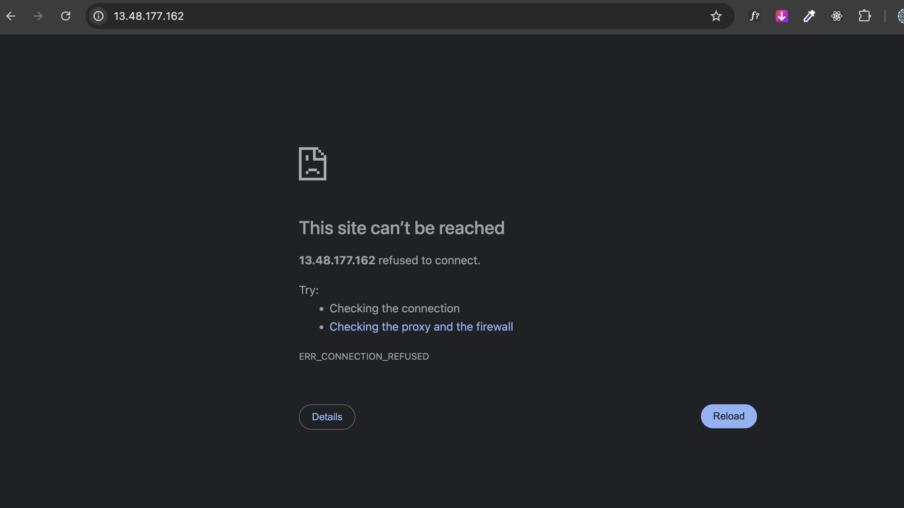

The system log showed `apt-get: command not found` and the operating system as Amazon Linux 2023:

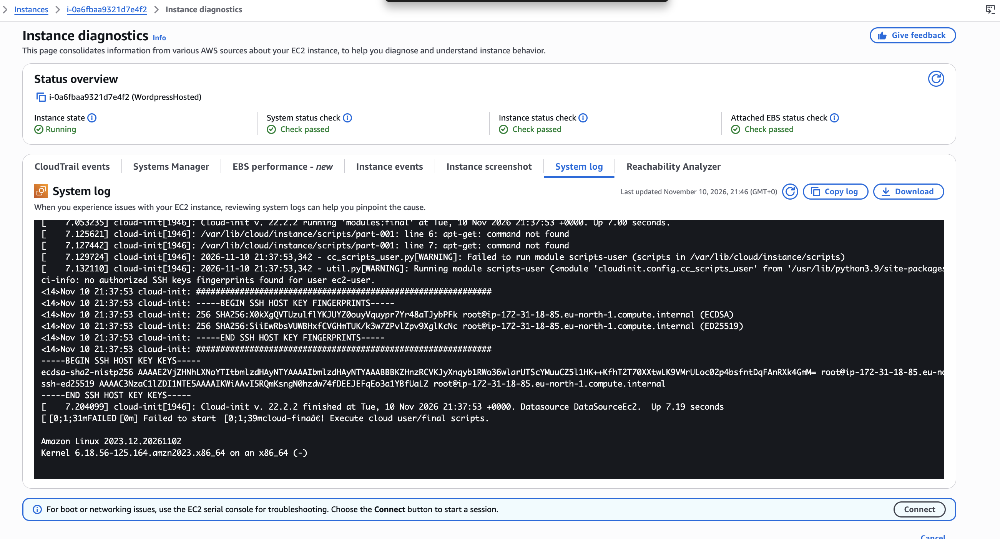

## 3. I connected it to the existing network

I used the default VPC and one of its existing public subnets. I looked up the default VPC with a Terraform data block and supplied the subnet ID to the EC2 resource.

I initially used a VPC resource block while trying to refer to the existing VPC. I learned that a data block looks up existing information, while a resource block describes something Terraform should manage.

I also checked why the subnet was public. Its route table had 0.0.0.0/0 pointing to an internet gateway. The subnet had public IPv4 assignment enabled, which gave my instance a public address when it launched.

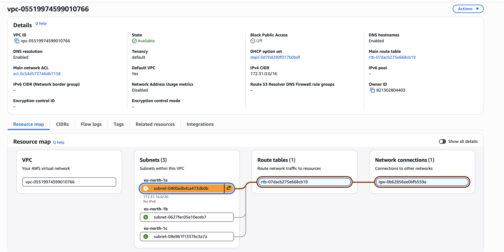

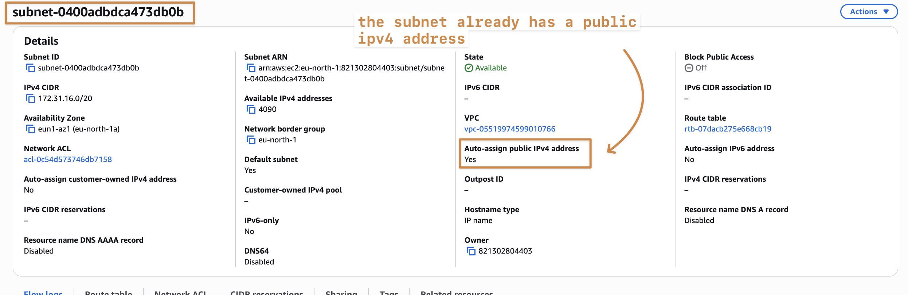

## 4. I created the security group and its rules

I created a security group, a separate incoming rule and a separate outgoing rule. The incoming rule allowed TCP port 80 from any IPv4 address so people could open the website over HTTP. The outgoing rule allowed the instance to initiate connections to any IPv4 destination, including connections to download packages and WordPress.

I initially thought the outgoing rule was what allowed the server to reply to a visitor. I learned that security groups track connections, so replies to an allowed incoming connection are automatically allowed.

I attached the security group using vpc_security_group_ids. Terraform validation also caught a reference where I had passed the whole VPC object into an argument that needed a string ID. Adding .id gave it the value it expected.

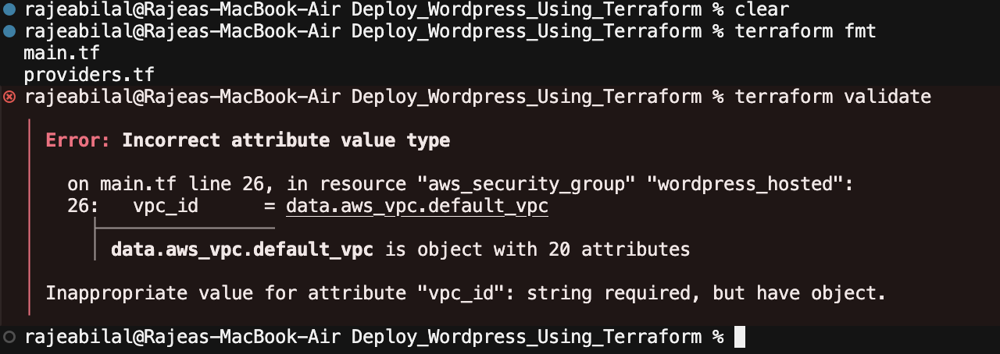

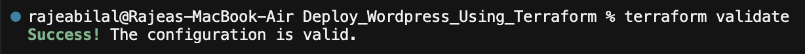

## 5. I checked the configuration and launched the instance

I ran terraform fmt to format the files, terraform validate to check the configuration, and terraform plan to review the proposed changes. Then I ran terraform apply to create the resources.

At this stage, the four managed resources were the EC2 instance, the security group and its two rules. The VPC and subnet already existed.

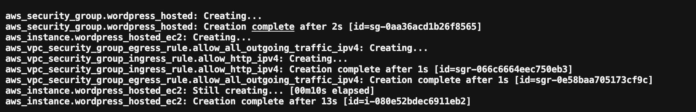

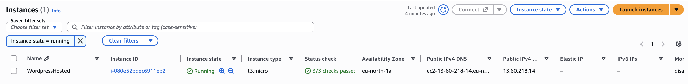

## 6. I built the startup script in stages

I created user-data.sh and used user_data = file("user-data.sh") to supply its contents to EC2. These Bash commands run on the instance when it first starts.

I started by updating Ubuntu's package list and installing Nginx. Once I could open the Nginx welcome page, I added PHP-FPM and tested that PHP could run. I then added MySQL Server, the PHP MySQL extension and curl.

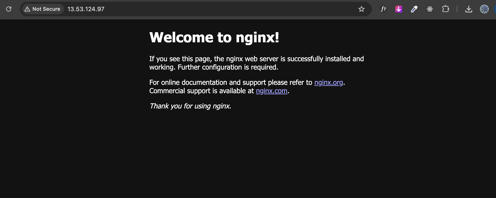

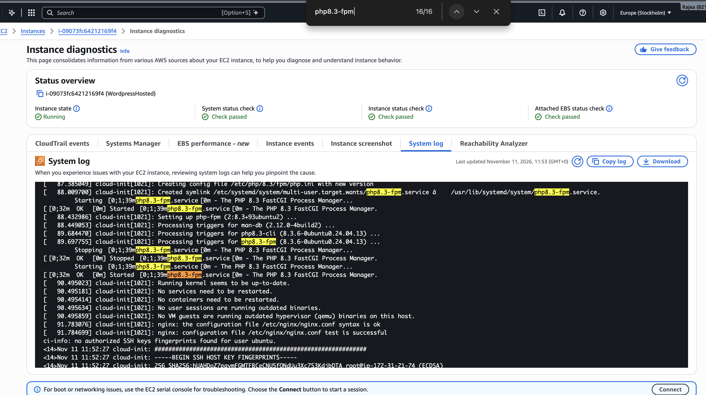

I had to understand the difference between these packages. Nginx handles browser requests. PHP-FPM runs the WordPress PHP code. MySQL stores the site's data. The PHP MySQL extension lets the PHP code communicate with MySQL.

I configured Terraform to replace the practice instance when the user data changed. Each replacement gave me a fresh machine on which to test the updated script.

## 7. I gave WordPress a database and configured Nginx

The script created a database called MySQL_DB, generated a password and created a database user called wordpress_user. It gave that user permission to work with this database. This was the login WordPress would use to connect to MySQL. I created my website admin account later in the browser.

I used curl to download the compressed WordPress files and tar to unpack them into /var/www/wordpress. The script then wrote the database name, username, password and location into wp-config.php.

The cat blocks were confusing at first. I learned that they write several lines of text into a file on EC2. I used one for the WordPress configuration and another for the Nginx configuration.

I set wp-config.php to be owned by root, with the www-data group able to read it. That allowed the PHP-FPM processes running WordPress to read the connection details. These file permissions were separate from the permissions I had granted inside MySQL.

Finally, I pointed Nginx at the WordPress folder and configured it to send PHP requests to PHP-FPM. I restarted PHP-FPM to load the MySQL extension, checked the Nginx configuration and reloaded Nginx.

## 8. I tested the complete site and investigated the failures

I opened the public IP address, completed the WordPress setup and published a post. This tested that WordPress could save content to the database and display it in the browser.

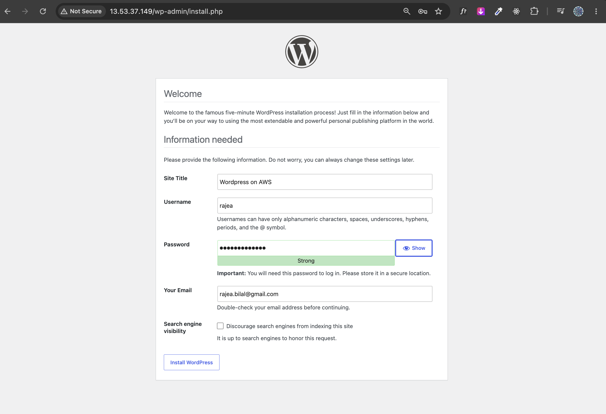

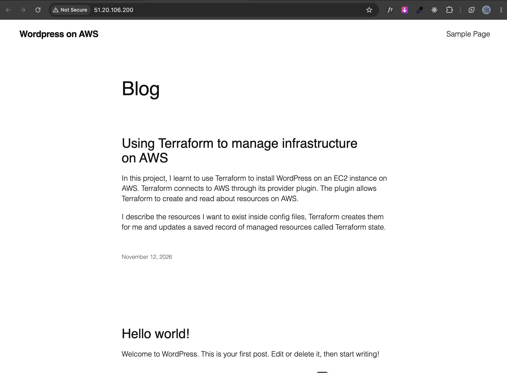

I learned that a successful Terraform apply does not confirm that every command inside the startup script succeeded. When I kept seeing the Nginx welcome page, I checked the cloud-init output to see how far the script had reached. I found the logs difficult to read at first, but they became useful once I knew which messages to look for.

The bigger problem came after the site had worked. It became slow and showed an error establishing a database connection. The system log showed Linux repeatedly killing mysqld because the instance had run out of memory. I changed the instance type to t3.small, increasing RAM from 1 GiB to 2 GiB, and the site responded again.

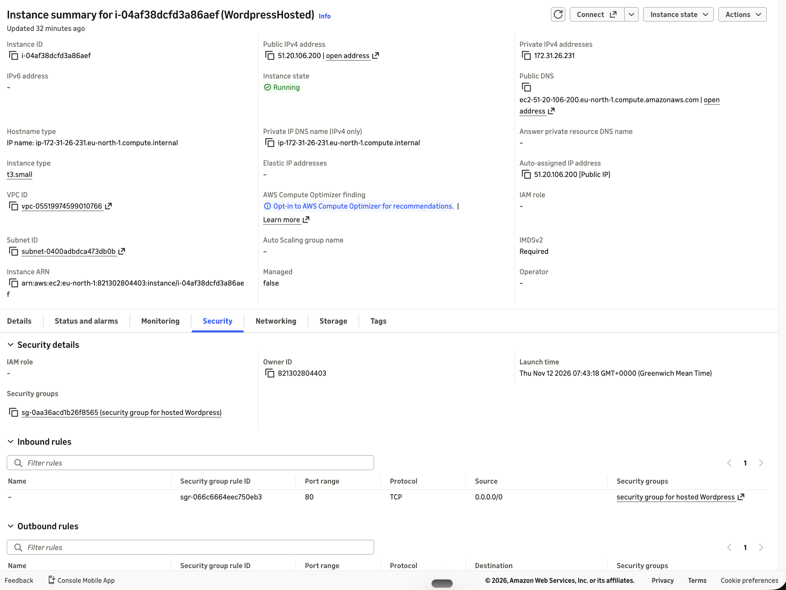

Resizing also changed the public IP. I could open the homepage at the new address, but links such as Sample Page still pointed to the old one. WordPress had saved the original site address in its database. I learned that its WordPress Address and Site Address settings need to match the address being used to access the site.

The site I tested used HTTP through the instance's public IPv4 address. The infrastructure and startup commands were described in the project files, and I completed the final WordPress site setup in the browser.
